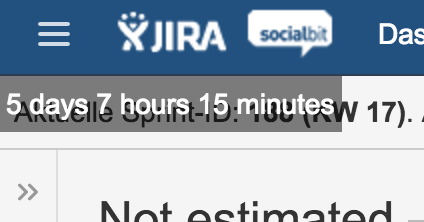

# userscripts

Drei Userscripts für Tampermonkey, die ich mir 2016 bei meinem damaligen Arbeitgeber gebastelt habe. Alle drei hängen an Seiten, mit denen ich täglich zu tun hatte.

## Workload

Rechnet im Jira-Issue-Filter die geschätzten Zeiten aller angezeigten Tickets zusammen und zeigt oben links, wie viele Tage Arbeit das ergibt (bei acht Stunden pro Tag). Praktisch, um zu sehen, ob ein Sprint überhaupt in die Woche passt.

Filter setzen, zum Beispiel `resolution = Unresolved AND assignee in (currentUser()) AND Sprint = "..."`, Seite neu laden, Summe steht oben links.

## Zeitverwaltung

Liest die Monatsübersicht der internen Zeiterfassung aus, zieht die Zeiten der Arbeitstage heraus und rechnet daraus die Überstunden. Zusätzlich rechnet es mit einem festen Stundensatz und einem Nettofaktor aus, was diese Stunden ungefähr wert wären. Die Werte stehen oben im Skript und sind auf mich zugeschnitten.

## BitbucketPullRequests

Blendet auf der Bitbucket-Pull-Request-Übersicht die Requests aus, die mich nichts mehr angehen: alles mit `WIP` im Titel und alles, was schon genug Approvals hat. Dazu ein Knopf, der die verbliebenen Pull Requests auf einmal in neuen Tabs öffnet.

## Hinweis

Alle drei Skripte matchen auf Domains meines damaligen Arbeitgebers und auf die Bitbucket- und Jira-Oberflächen von 2016. Sie funktionieren heute nirgends mehr unverändert. Sie liegen hier als Notiz, wie sich so etwas mit ein paar Zeilen jQuery lösen ließ.
